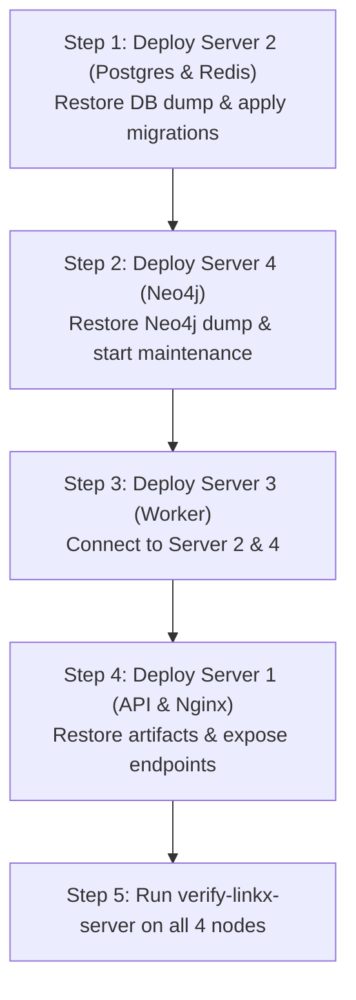

# LinkX Enterprise Disaster Recovery Playbook

**Scope**: National-scale distributed LinkX clusters (NBE/BDR cluster on `172.27.23.0/24` and CDR cluster on `172.21.13.0/24`).  
**Authoritative Location**: `docs/disaster_recovery_playbook.md`  
**Last Updated**: October 2026

---

## 1. Overview, RTO, and RPO Targets

| Metric | Target | Rationale |
|---|---|---|
| **RPO (Recovery Point Objective)** | **< 24 Hours** | Automated nightly backups with SHA256 integrity verification across Postgres, Neo4j, and Artifacts |
| **RTO (Recovery Time Objective)** | **< 15 Minutes** (Single Server)<br/>**< 45 Minutes** (Full Cluster Rebuild) | Turnkey container-based architecture, automated schema migrations, and single-command restore tooling |

---

## 2. Backup Inventory & Storage Matrix

| Service | Primary Host | Backup Root | Schedule | Script / Unit |
|---|---|---|---|---|
| **PostgreSQL (Control Data)** | Server 2 (Node-20) | `/opt/linkx-backups/postgres` | Daily 02:00 UTC | `linkx-postgres-backup.timer`<br/>[`backup-postgres.sh`](file:///var/www/linkx-backend/service_factory/services/linkx-control-data/scripts/backup-postgres.sh) |
| **Neo4j Enterprise** | Server 4 (Node-22) | `/opt/linkx-backups/neo4j` | Weekly Sun 03:00 UTC | `linkx-neo4j-backup.timer`<br/>[`backup-neo4j-offline.sh`](file:///var/www/linkx-backend/service_factory/services/Linkx_xmaintenance/scripts/backup-neo4j-offline.sh) |
| **NFS Artifacts & Configs** | Server 1 (Node-19) | `/opt/linkx-backups/artifacts` | Daily 02:30 UTC | `linkx-artifacts-backup.timer`<br/>[`backup-artifacts.sh`](file:///var/www/linkx-backend/service_factory/scripts/backup-artifacts.sh) |
| **Off-Host Replication** | All hosts | Configured remote target | Daily post-backup | [`sync-backups-offhost.sh`](file:///var/www/linkx-backend/service_factory/scripts/sync-backups-offhost.sh) |

---

## 3. Disaster Recovery Procedures

### Scenario A: Server 2 Failure (PostgreSQL & Redis Control Plane)

**Symptoms**: API returns 500 on database queries, Celery workers cannot claim jobs, Redis PING fails.

#### Recovery Steps:

1. **Verify or Rebuild Server 2 Infrastructure**:
   ```bash
   cd /opt/linkx-control-data
   sudo docker compose ps
   ```
   If container volume is corrupted or lost:
   ```bash
   sudo docker compose down -v
   sudo docker compose up -d
   ```

2. **Identify Latest Backup File**:
   ```bash
   ls -lt /opt/linkx-backups/postgres/*.dump | head -n 1
   ```

3. **Verify SHA256 Checksum**:
   ```bash
   sha256sum -c /opt/linkx-backups/postgres/<backup-filename>.sha256
   ```

4. **Restore Database**:
   ```bash
   sudo bash /opt/linkx-backend-update/service_factory/services/linkx-control-data/scripts/restore-postgres.sh /opt/linkx-backups/postgres/<backup-filename>.dump
   ```

5. **Re-apply Latest Schema Migrations**:
   ```bash
   for sql in /opt/linkx-backend-update/service_factory/services/linkx-control-data/postgres/migrations/*.sql; do
       echo "Applying $sql..."
       sudo docker exec -i linkx-postgres psql -U linkx -d linkx < "$sql"
   done
   ```

6. **Verify Service Health**:
   ```bash
   sudo python3 /opt/linkx-backend-update/service_factory/deploy/security/verify-linkx-server.py --role control-data
   ```

---

### Scenario B: Server 4 Failure (Neo4j Graph Database & Maintenance)

**Symptoms**: Graph analysis jobs fail with Bolt connection refused on port 7687; graph status shows error.

#### Recovery Steps:

1. **Verify / Prepare Server 4 Container**:
   ```bash
   sudo docker stop linkx-neo4j || true
   sudo systemctl stop linkx-xcleanup-worker linkx-xcleanup-scheduler || true
   ```

2. **Select Latest Verified Neo4j Dump**:
   ```bash
   LATEST_DIR=$(ls -td /opt/linkx-backups/neo4j/* | head -n 1)
   echo "Restoring from $LATEST_DIR"
   ```

3. **Execute Turnkey Restore Script**:
   ```bash
   sudo bash /opt/linkx-backend-update/service_factory/services/Linkx_xmaintenance/scripts/restore-neo4j.sh "$LATEST_DIR/neo4j.dump"
   ```
   *The script automatically verifies SHA256 checksums, mounts the data volume, loads the dump with `--overwrite-destination=true`, and restarts both Neo4j and the xCleanup background workers.*

4. **Verify Graph Connectivity & Indexes**:
   ```bash
   sudo python3 /opt/linkx-backend-update/service_factory/deploy/security/verify-linkx-server.py --role graph-maintenance
   ```

---

### Scenario C: Server 1 Failure (API Gateway & Web Services)

**Symptoms**: Front-end portal unreachable, Nginx 502/504 bad gateway, Gunicorn inactive.

#### Recovery Steps:

1. **Deploy Application Code & Configuration**:
   ```bash
   cd /opt/linkx-backend-update
   git pull origin main
   sudo bash deploy.sh --role api --yes
   ```

2. **Restore Artifacts & Session Files (if storage volume was lost)**:
   ```bash
   LATEST_ART=$(ls -t /opt/linkx-backups/artifacts/*.tar.gz | head -n 1)
   sudo bash /opt/linkx-backend-update/service_factory/scripts/restore-artifacts-to-dir.sh "$LATEST_ART" /mnt/linkx-artifacts
   ```

3. **Verify Security & Runtime Configuration**:
   ```bash
   sudo python3 /opt/linkx-backend-update/service_factory/deploy/security/verify-linkx-server.py --role api
   ```

---

### Scenario D: Server 3 Failure (Distributed Analytics Worker)

**Symptoms**: Jobs remain in `PENDING` status indefinitely; Celery/worker queues build up.

#### Recovery Steps:

1. **Deploy Worker Engine**:
   ```bash
   cd /opt/linkx-backend-update
   git pull origin main
   sudo bash deploy.sh --role worker --yes
   ```

2. **Verify Systemd Service Status**:
   ```bash
   sudo systemctl status linkx-worker.service
   ```

3. **Run Health Verification**:
   ```bash
   sudo python3 /opt/linkx-backend-update/service_factory/deploy/security/verify-linkx-server.py --role worker
   ```

---

### Scenario E: Complete Cluster Rebuild (Total Catastrophe / Greenfield Provisioning)

If an entire physical or virtual cluster is destroyed:



1. **Deploy Server 2 (Control Data)** first, as all services depend on PostgreSQL and Redis.
2. **Deploy Server 4 (Graph Data)** second, enabling graph procedure and schema verification.
3. **Deploy Server 3 (Worker)** third, connecting to both databases.
4. **Deploy Server 1 (API)** last, exposing ingress only when downstream storage is active.
5. **Run Verification** on all 4 servers using `verify-linkx-server.py --role <role>`.

---

## 4. Non-Destructive Restore Drill Protocol

To verify backup integrity periodically without impacting live production data:

1. **PostgreSQL Drill Target**:
   Use test target database `linkx_restore_test`:
   ```bash
   POSTGRES_DB=linkx_restore_test sudo bash /opt/linkx-backend-update/service_factory/services/linkx-control-data/scripts/restore-postgres.sh /opt/linkx-backups/postgres/<filename>.dump
   ```
2. **Artifacts Drill Target**:
   Restore into temporary directory:
   ```bash
   mkdir -p /tmp/linkx_artifact_drill
   sudo bash /opt/linkx-backend-update/service_factory/scripts/restore-artifacts-to-dir.sh <backup.tar.gz> /tmp/linkx_artifact_drill
   rm -rf /tmp/linkx_artifact_drill
   ```
3. **Automated Verification**:
   Run the test runner on any server:
   ```bash
   sudo python3 /opt/linkx-backend-update/service_factory/deploy/security/verify-linkx-backups.py
   ```
