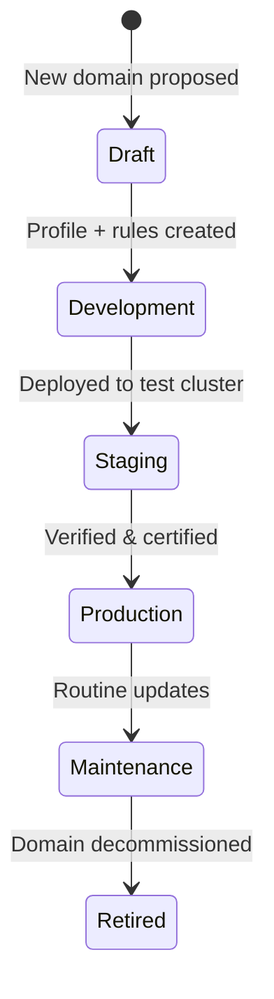
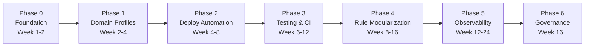

# LinkX Multi-Domain Development Strategy

**Document Type**: Master Development Roadmap & Architecture Strategy  
**Version**: 1.0  
**Created**: October 2026  
**Scope**: Governance of LinkX across BDR (Bank Data Records / NBE), CDR (Call Data Records / Telecom), and all future analytical domains  
**Audience**: Core Engineering, DevOps, Institutional Stakeholders  

---

## Executive Summary

LinkX has organically grown from a single-domain banking AML platform into a **multi-domain distributed graph analytics engine** now serving two independent 4-server clusters:

| Cluster | Domain | Subnet | Purpose |
| :--- | :--- | :--- | :--- |
| **NBE Cluster** | BDR (Bank Data Records) | `172.27.23.0/24` | National Bank of Ethiopia — transaction-based AML |
| **CDR Cluster** | CDR (Call Data Records) | `172.21.13.0/24` | Telecom intelligence — call pattern & fraud analysis |

The codebase is **identical across both clusters** — domain behavior is controlled entirely through **database-seeded session configurations** and **`.env` environment variables** on each cluster. This document defines the phased strategy to formalize, harden, and scale this architecture for **national-scale deployment** with support for **unlimited future domains** (insurance, customs, securities, etc.).

### Why Single-Trunk + Domain Profiles?

> [!IMPORTANT]
> LinkX uses **one `main` branch, one codebase, one deployment pipeline**. Domains are NOT code branches — they are **configuration profiles** seeded into PostgreSQL at deployment time. This was a deliberate architectural decision based on:
>
> 1. **Operational simplicity**: One codebase to maintain, one set of tests, one CI pipeline.
> 2. **Domain explosion protection**: If each domain had its own branch, 5 domains × 4 servers = 20 diverging codebases. Merge conflicts would become unmanageable.
> 3. **Rule modularity already exists**: `public/temp_rules/bank_transactions_rules.py`, `call_data_records_rules.py`, and `social_media_(tweeter)_rules.py` are loaded dynamically by the `active_rule` field in `user_configs`.
> 4. **Config defaults are `.env`-aware**: `config_defaults.py` reads 40+ environment variables (`LINKX_STORAGE_PATH`, `LINKX_DEFAULT_SOURCE_COL`, etc.) — changing the `.env` on a cluster changes its entire behavior without touching code.

---

## Phase 0: Foundation Audit & Cleanup (Week 1–2)

**Goal**: Establish a clean baseline before introducing structural changes.

### 0.1 Repository Hygiene

The root directory currently contains **60+ loose `fix_*.py` / `refactor_*.py` scripts** from historical debugging sessions. These create noise and confusion for new operators.

**Actions**:
- Move all one-off fix/refactor scripts into an `archive/historical_patches/` directory.
- Move standalone test scripts (`test_cypher.py`, `test_pool.py`, `test_rotation.py`, etc.) into `tests/legacy/`.
- Ensure `.gitignore` excludes `__pycache__/`, `*.pyc`, `.env`, `venv/`, and local scratch files.

### 0.2 Documentation Consolidation

Current handoff docs in `docs/` total 38 files covering security, architecture, API specs, risk scoring, and xVigilance. Many reference the original single-cluster (NBE) topology.

**Actions**:
- Add a `docs/README.md` index that categorizes all handoff documents by topic (deployment, security, API, analysis, architecture).
- Update `server_communication_and_update_protocol.md` to reference **both** cluster topologies (NBE `172.27.23.0/24` and CDR `172.21.13.0/24`).
- Ensure all docs reference the correct hostnames per cluster (e.g., `node-19` for NBE vs `node19` for CDR).

### 0.3 Config Defaults Deduplication

`config_defaults.py` currently exists in **5 locations**:
1. `batch_manager/config_defaults.py` (root monolith)
2. `service_factory/services/linkx-api/src/batch_manager/config_defaults.py`
3. `service_factory/services/linkx-worker/src/batch_manager/config_defaults.py`
4. `service_factory/services/Linkx_xmaintenance/src/batch_manager/config_defaults.py`
5. (Possibly inside `service_factory/services/linkx-control-data/`)

All 5 copies must remain identical. Currently, synchronization is manual (`cp -r`).

**Actions**:
- Add a `scripts/sync-service-sources.sh` that copies the canonical `batch_manager/` tree into all 4 service packages automatically.
- Add a pre-commit check (or CI step) that verifies all 4 copies are byte-identical.

---

## Phase 1: Domain Profile Formalization (Week 2–4)

**Goal**: Formalize how domains are defined, stored, and applied — making onboarding a new domain a **configuration-only** operation.

### 1.1 Domain Profile Registry

Create a structured domain profile system:

```
domains/
├── banking/
│   ├── profile.json          # Default session config overrides for BDR
│   ├── seed.sql              # PostgreSQL seed for user_configs / session_configs
│   └── rules.py              # Symlink or copy of bank_transactions_rules.py
├── cdr/
│   ├── profile.json          # Default session config overrides for CDR
│   ├── seed.sql              # PostgreSQL seed (already exists as seed-cdr-session-config.sql)
│   └── rules.py              # Symlink or copy of call_data_records_rules.py
├── social_media/
│   ├── profile.json
│   ├── seed.sql
│   └── rules.py
└── _template/
    ├── profile.json.template # Blank template for new domains
    ├── seed.sql.template
    └── rules.py.template
```

Each `profile.json` encodes:
```json
{
  "domain_id": "cdr",
  "display_name": "Call Data Records",
  "active_rule": ["call data records"],
  "storage_path": "user/cdr/cleaned_partitioned",
  "storage_databases": ["cdrdb"],
  "storage_tables": ["call_records", "sms_records"],
  "default_source_col": "CALLING_NO",
  "default_target_col": "CALLED_NO",
  "default_relationship": "CALLED_TO",
  "date_column": "START_TIME",
  "fetch_columns": ["CALLING_NO", "CALLED_NO", "START_TIME", "DURATION", "CALL_TYPE"],
  "search_columns_strict": ["CALLING_NO", "CALLED_NO", "START_TIME"],
  "search_columns_fuzzy": ["CALLING_NO", "CALLED_NO", "CALL_TYPE", "DURATION"]
}
```

### 1.2 Domain-Aware `.env` Template

Add a single new `.env` variable to formalize domain identity:

```ini
# Domain Identity (determines which profile.json and rule modules are active)
LINKX_DOMAIN=banking       # Options: banking, cdr, social_media, etc.
```

> [!NOTE]
> This variable is **informational only at this phase** — it does NOT change code behavior. The actual domain behavior remains controlled by what's seeded into PostgreSQL. The variable serves as a label for operators and future automation scripts.

### 1.3 Onboarding Playbook

Create `docs/domain_onboarding_playbook.md` — a step-by-step guide for adding a new domain:

1. Copy `domains/_template/` to `domains/<new_domain>/`.
2. Fill in `profile.json` with column mappings, rule names, and storage paths.
3. Write the Cypher rules in `rules.py` (following the pattern in `call_data_records_rules.py`).
4. Generate `seed.sql` from `profile.json`.
5. Deploy to a fresh cluster using the standard 4-server handoff guide.
6. Set `LINKX_DOMAIN=<new_domain>` in all `.env` files.
7. Run `apply-<domain>-session-config.sh` on Server 2.
8. Verify with `verify-linkx-server.py` on all 4 nodes.

---

## Phase 2: Deployment Automation & Integrity (Week 4–8)

**Goal**: Eliminate manual `cp -r` / `systemctl restart` human error. Make deployments repeatable, auditable, and rollback-safe.

### 2.1 Unified Deploy Script

Replace the 3 separate deploy scripts (`deploy-api.sh`, `deploy-worker.sh`, `deploy-maintenance.sh`) with a single role-aware deploy script:

```bash
# Usage on any server:
sudo bash deploy.sh --role api
sudo bash deploy.sh --role worker
sudo bash deploy.sh --role graph-maintenance
sudo bash deploy.sh --role control-data
```

The script will:
1. `git pull origin main` (with safe-directory handling).
2. Copy source files to the correct deploy path.
3. Install any new pip dependencies.
4. Restart the correct systemd unit(s).
5. Wait for boot.
6. Run `verify-linkx-server.py --role <role>`.
7. Log the deployment (commit hash, timestamp, hostname) to a local file and optionally to PostgreSQL.

### 2.2 Deployment Audit Log

Add a `deployment_audit_log` table to PostgreSQL:

```sql
CREATE TABLE IF NOT EXISTS deployment_audit_log (
    id              SERIAL PRIMARY KEY,
    deployed_at     TIMESTAMPTZ NOT NULL DEFAULT NOW(),
    hostname        TEXT NOT NULL,
    role            TEXT NOT NULL,
    git_commit      TEXT NOT NULL,
    git_branch      TEXT NOT NULL DEFAULT 'main',
    domain          TEXT,
    verify_result   TEXT,       -- 'PASS' or 'FAIL'
    failures        INTEGER DEFAULT 0,
    warnings        INTEGER DEFAULT 0,
    operator        TEXT
);
```

This provides institutional traceability: "What version was on node22 on September 15th?"

### 2.3 Pre-Deploy Diff Preview

Before copying files, the deploy script should:
1. Show a `diff` summary between the repo source and the live deploy directory.
2. Require explicit confirmation (unless `--yes` flag is passed).
3. Create a timestamped backup of the current live source: `/opt/linkx-backend-api/src.bak.<timestamp>`.

### 2.4 Rollback Mechanism

```bash
# Rollback to the previous deployment:
sudo bash deploy.sh --role api --rollback
```

This restores from the most recent `.bak` snapshot and restarts the service.

---

## Phase 3: Testing & Quality Gate (Week 6–12)

**Goal**: Introduce automated testing to prevent regressions across domains. No untested code reaches production clusters.

### 3.1 Test Infrastructure

```
tests/
├── conftest.py                # Shared fixtures (mock DB, mock Redis, mock Neo4j)
├── unit/
│   ├── test_config_defaults.py       # Verify all .env combinations produce valid configs
│   ├── test_rules_banking.py         # Unit test bank_transactions_rules.py
│   ├── test_rules_cdr.py             # Unit test call_data_records_rules.py
│   └── test_session_manager.py       # Verify session lifecycle
├── integration/
│   ├── test_api_health.py            # Smoke test /db/health, /auth/me
│   ├── test_worker_job_claim.py      # Verify job claim/lock on PostgreSQL
│   └── test_neo4j_connectivity.py    # Verify Bolt connection and procedure availability
└── domain/
    ├── test_banking_profile.py       # Load banking profile.json, verify schema
    └── test_cdr_profile.py           # Load CDR profile.json, verify schema
```

### 3.2 Domain Profile Validation Tests

Automated tests that load each `domains/<name>/profile.json` and verify:
- All required fields are present.
- Column names don't contain banking-specific terms in CDR profiles (and vice versa).
- `seed.sql` is syntactically valid PostgreSQL.
- `rules.py` exports the expected `RELATIONSHIPS` list.

### 3.3 Cross-Domain Leak Detection

A dedicated test that:
1. Loads the CDR profile.
2. Generates a mock session config.
3. Asserts zero occurrences of banking terms (`AMOUNTINBIRR`, `ACCOUNTNO`, `BENACCOUNTNO`, `bankdb`, `BALANCEHELD`).
4. Vice versa for banking profile vs CDR terms.

This prevents the exact issue we manually fixed during the CDR cluster deployment.

### 3.4 CI Pipeline (GitHub Actions)

```yaml
# .github/workflows/ci.yml
name: LinkX CI
on: [push, pull_request]
jobs:
  test:
    runs-on: ubuntu-latest
    steps:
      - uses: actions/checkout@v4
      - uses: actions/setup-python@v5
        with:
          python-version: '3.11'
      - run: pip install -r requirements.txt
      - run: pytest tests/unit/ -v
      - run: pytest tests/domain/ -v
      - run: python scripts/verify-source-sync.py  # Ensure all 4 service copies match
```

> [!TIP]
> Start with unit and domain profile tests only. Integration tests require Docker (PostgreSQL, Redis, Neo4j) and should be added in Phase 5 when the CI environment is mature.

---

## Phase 4: Rule Engine Modularization (Week 8–16)

**Goal**: Transform the monolithic `LA_rules_script.py` (2400+ lines) into a pluggable, domain-driven rule engine.

### 4.1 Current State Analysis

`LA_rules_script.py` contains:
- `TRANSACTION_RELATIONSHIPS` — 8 banking typologies (smurfing, circular flow, fund flow, etc.)
- `CDR_RELATIONSHIPS` — 14 telecom typologies (call sequence, callback pattern, frequent contact, etc.)
- Shared utility functions for graph traversal, timestamp parsing, and batch processing.

Both relationship lists are always present in memory regardless of which domain is active. The `active_rule` field in `user_configs` determines which rules execute.

### 4.2 Modular Rule Architecture

```
batch_manager/analyzing/
├── __init__.py
├── analyzer.py               # Orchestrator (unchanged)
├── LA_graphs_script.py        # Graph construction (unchanged)
├── rule_engine/
│   ├── __init__.py            # Registry: discovers and loads rule modules
│   ├── base.py                # Abstract base class for rule definitions
│   ├── banking.py             # TRANSACTION_RELATIONSHIPS (extracted from LA_rules_script.py)
│   ├── cdr.py                 # CDR_RELATIONSHIPS (extracted from LA_rules_script.py)
│   ├── social_media.py        # Social media rules
│   └── _shared.py             # Shared Cypher utilities, timestamp helpers
└── LA_rules_script.py         # PRESERVED as compatibility shim — imports from rule_engine/
```

> [!WARNING]
> **`LA_rules_script.py` must NOT be deleted or renamed.** It is imported by name across all 4 service packages. The refactored version becomes a thin shim that re-exports from `rule_engine/`, maintaining full backward compatibility.

### 4.3 Rule Discovery Pattern

```python
# rule_engine/__init__.py
import importlib, pkgutil

_RULE_REGISTRY = {}

def discover_rules():
    """Auto-discover all rule modules in this package."""
    for importer, modname, ispkg in pkgutil.iter_modules(__path__):
        if modname.startswith('_') or modname == 'base':
            continue
        mod = importlib.import_module(f'.{modname}', __package__)
        if hasattr(mod, 'RELATIONSHIPS'):
            _RULE_REGISTRY[modname] = mod.RELATIONSHIPS
    return _RULE_REGISTRY
```

This means adding a new domain's rules is as simple as dropping a `.py` file into `rule_engine/` with a `RELATIONSHIPS` list.

### 4.4 `public/temp_rules/` Integration

The existing `public/temp_rules/` directory (where operators upload custom `.py` rule files via the frontend) remains unchanged. The `uploaded_rule_engine.py` already dynamically imports from this path. The new `rule_engine/` package handles **built-in** rules only.

---

## Phase 5: Observability & National-Scale Operations (Week 12–24)

**Goal**: Build the monitoring, alerting, backup, and disaster recovery infrastructure required for a national-scale deployment serving multiple government agencies.

### 5.1 Centralized Monitoring Dashboard

Current state: Each server exposes OpenTelemetry metrics on port `8889`, scraped by a Prometheus instance at `172.27.23.36`. However:
- No Grafana dashboards exist.
- No alerting rules are configured.
- CDR cluster (`172.21.13.0/24`) is not yet integrated into monitoring.

**Actions**:
- Deploy Grafana (or extend existing Prometheus) with dashboards per cluster:
  - **API Dashboard**: Request rate, latency P50/P95/P99, error rate, active WebSocket connections.
  - **Worker Dashboard**: Job queue depth, active job count, job duration histograms, failures.
  - **Neo4j Dashboard**: Heap usage, page cache hit ratio, query execution time, active transactions.
  - **PostgreSQL Dashboard**: Connection pool usage, query latency, table sizes, replication lag.
  - **Redis Dashboard**: Memory usage, key count, command rate, slow log.
- Configure Prometheus alerting rules for:
  - Service down (systemd unit inactive for > 60s).
  - Job queue backlog exceeding threshold.
  - Neo4j heap > 90%.
  - Disk usage > 85%.
  - Redis memory > 80% of maxmemory.

### 5.2 Cross-Cluster Monitoring

Both NBE and CDR clusters must report to a **shared monitoring plane** or federated Prometheus instances. Define:

```
                 ┌─────────────────────┐
                 │   Central Grafana   │
                 │  (Operator Console) │
                 └──────┬──────┬───────┘
                        │      │
           ┌────────────┘      └────────────┐
           ▼                                ▼
  ┌─────────────────┐            ┌─────────────────┐
  │ NBE Prometheus  │            │ CDR Prometheus  │
  │ 172.27.23.36    │            │ 172.21.13.xx    │
  │ Scrapes 4 nodes │            │ Scrapes 4 nodes │
  └─────────────────┘            └─────────────────┘
```

### 5.3 Backup & Disaster Recovery

#### PostgreSQL (Server 2)
- **Automated daily backups**: `pg_dump` via cron, compressed, rotated (keep 30 days).
- **WAL archiving**: Enable continuous WAL archival for point-in-time recovery.
- **Off-site copy**: Backup files synced to a secondary storage node or object storage.

#### Neo4j (Server 4)
- **Online backup**: `neo4j-admin database dump` (Community) or `neo4j-admin backup` (Enterprise) via weekly cron.
- **Consistent snapshots**: Pause xCleanup scheduler before backup, resume after.

#### NFS Artifacts (Server 1)
- **rsync mirror**: Nightly `rsync` of `/mnt/linkx-artifacts/` to a backup volume.

#### Recovery Playbook
Document recovery procedures in `docs/disaster_recovery_playbook.md`:
1. **Server 2 failure**: Restore PostgreSQL from backup, restart Redis, re-verify all consumers.
2. **Server 4 failure**: Restore Neo4j from dump, re-mount NFS, restart maintenance services.
3. **Full cluster failure**: Re-deploy from scratch using the 4-server handoff guide with backup data.

### 5.4 Log Aggregation

Centralize logs from all 8 servers (both clusters) into a shared log store:
- **Option A**: Ship systemd journal logs to Elasticsearch/OpenSearch via Fluentd/Filebeat.
- **Option B**: Ship to Loki (lightweight, works well with Grafana).

Minimum log retention: **90 days** for compliance and audit trail requirements.

---

## Phase 6: Multi-Domain Governance & Future Extensibility (Week 16–Ongoing)

**Goal**: Establish the organizational and technical framework for safely introducing new domains without destabilizing production.

### 6.1 Domain Lifecycle Management

Define formal stages for each domain:



### 6.2 New Domain Onboarding Checklist

| Step | Action | Verification |
| :---: | :--- | :--- |
| 1 | Create `domains/<name>/profile.json` | Schema validation passes |
| 2 | Write Cypher rules in `domains/<name>/rules.py` | Unit tests pass |
| 3 | Generate `seed.sql` from profile | SQL syntax check passes |
| 4 | Provision 4-server cluster | Pre-flight audit passes (Section 4 of handoff) |
| 5 | Deploy code (git clone + deploy scripts) | All 4 nodes verify `failures=0` |
| 6 | Seed domain config into PostgreSQL | `check-cdr-config.py` equivalent passes |
| 7 | Execute smoke test (ingest → analyze → graph) | End-to-end pipeline produces expected graph |
| 8 | Network hardening (UFW) | UFW active, cluster subnet whitelisted |
| 9 | Monitoring integration | Prometheus scraping all 4 nodes |
| 10 | Operator certification sign-off | Scorecard filed in handoff doc |

### 6.3 Cross-Domain Query Federation (Future Vision)

As the number of domains grows, institutional users may need to **correlate insights across domains** — e.g., "Show me all entities that appear in both banking transactions AND CDR call records."

This requires:
- A **federation layer** that can query multiple Neo4j instances across clusters.
- Shared entity identifiers (phone numbers, national IDs, business registration numbers).
- A cross-cluster API gateway.

> [!NOTE]
> Cross-domain federation is a **Phase 6+ capability**. It should NOT be built until at least 3 domains are operational and a clear institutional need is documented. Pre-mature federation adds complexity without delivering value.

### 6.4 Domain-Specific Reporting Templates

Each domain may require unique compliance report formats:
- **BDR/Banking**: STR (Suspicious Transaction Reports) per NBE AML directives.
- **CDR/Telecom**: Pattern analysis reports per Ethiopian Telecom Authority requirements.
- **Future domains**: Custom templates per regulatory body.

The existing `report_integration_plan.md` and `report_pipeline_implementation_plan.md` architecture supports this — report templates are loaded by domain from the session config.

### 6.5 Capacity Planning Per Domain

Each domain has different resource profiles:

| Domain | Expected Data Volume | Neo4j Graph Size | Worker Memory | Special Requirements |
| :--- | :--- | :--- | :--- | :--- |
| **BDR** | 1–10M transactions/day | 10–100M nodes | 10 GiB | Hadoop/Hive integration, HDFS storage |
| **CDR** | 10–100M call records/day | 100M–1B nodes | 16+ GiB | Higher graph density, faster GDS algorithms |
| **Future** | Variable | Variable | Variable | Domain-specific data pipeline connectors |

> [!IMPORTANT]
> CDR clusters will likely require **higher Server 4 memory** (16 GiB+) due to denser graph structures from telecom call patterns. Plan hardware procurement accordingly.

---

## Phase Summary & Timeline



| Phase | Name | Duration | Risk if Skipped |
| :---: | :--- | :--- | :--- |
| **0** | Foundation Audit & Cleanup | 2 weeks | Accumulated tech debt slows every subsequent phase |
| **1** | Domain Profile Formalization | 2 weeks | New domains require ad-hoc manual configuration, error-prone |
| **2** | Deployment Automation & Integrity | 4 weeks | Human error during `cp`/`restart` cycles, no rollback capability |
| **3** | Testing & Quality Gate | 6 weeks | Regressions in one domain silently break another |
| **4** | Rule Engine Modularization | 8 weeks | 2400-line monolith becomes unmaintainable as rules multiply |
| **5** | Observability & Disaster Recovery | 12 weeks | Blind to failures, no recovery path for national-scale data loss |
| **6** | Multi-Domain Governance | Ongoing | Uncontrolled domain proliferation, no institutional accountability |

---

## Architectural Principles (Non-Negotiable)

These principles govern ALL development decisions across ALL phases:

1. **Single Trunk**: One `main` branch. No domain-specific branches. Ever.
2. **Config-Driven Behavior**: Domains differ by `.env` + database seeds, not by code forks.
3. **Zero Secrets in Git**: No passwords, keys, or tokens committed. Operators manage secrets via CLI and `.env` files on each server.
4. **Backward Compatibility**: Every refactoring phase must maintain import compatibility. No breaking renames of files imported across service packages.
5. **Verify Before Certify**: Every deployment runs `verify-linkx-server.py`. No server goes live without `failures=0`.
6. **Domain Isolation**: A CDR cluster must never process banking data. A banking cluster must never expose telecom data. Configuration seeds enforce this at the database level.
7. **Script Over Copy-Paste**: All deployment operations use committed scripts (`deploy.sh`, `apply-session-config.sh`). Raw terminal copy-paste of multi-line commands is prohibited.

---

## Appendix A: Current Cluster Inventory

### NBE / BDR Cluster (Bank Data Records)

| Server | Hostname | IP | Role |
| :--- | :--- | :--- | :--- |
| Server 1 | `node-19` | `172.27.23.95` | API Gateway |
| Server 2 | `node-20` | `172.27.23.106` | Control Data (PostgreSQL + Redis) |
| Server 3 | `node-21` | `172.27.23.18` | Worker |
| Server 4 | `node-22` | `172.27.23.85` | Neo4j + Maintenance |

### CDR Cluster (Call Data Records)

| Server | Hostname | IP | Role |
| :--- | :--- | :--- | :--- |
| Server 1 | `node19` | `172.21.13.70` | API Gateway |
| Server 2 | `node20` | `172.21.13.68` | Control Data (PostgreSQL + Redis) |
| Server 3 | `node21` | `172.21.13.66` | Worker |
| Server 4 | `node22` | `172.21.13.67` | Neo4j + Maintenance |

---

## Appendix B: File Reference Map

| Purpose | Current Location | Phase Affected |
| :--- | :--- | :--- |
| Master deployment guide | `docs/four_server_cluster_deployment_and_replication_handoff.md` | All |
| Update protocol & golden rules | `docs/server_communication_and_update_protocol.md` | Phase 2 |
| Banking rules (Cypher) | `public/temp_rules/bank_transactions_rules.py` | Phase 4 |
| CDR rules (Cypher) | `public/temp_rules/call_data_records_rules.py` | Phase 4 |
| Analysis engine (monolith) | `batch_manager/analyzing/LA_rules_script.py` | Phase 4 |
| Session config defaults | `batch_manager/config_defaults.py` | Phase 0, 1 |
| CDR database seed | `service_factory/deploy/security/seed-cdr-session-config.sql` | Phase 1 |
| Drift verification | `service_factory/deploy/security/verify-linkx-server.py` | Phase 2 |
| Deploy helpers | `deploy-api.sh`, `deploy-worker.sh`, `deploy-maintenance.sh` | Phase 2 |
| CDR config checker | `service_factory/deploy/security/check-cdr-config.py` | Phase 1, 3 |

---

*This document is maintained alongside the codebase. Update it as each phase progresses.*
